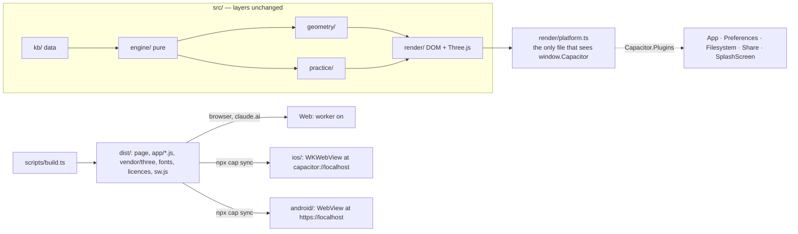

# NeuroLocalize on iOS and Android — plan

Written 2026-11-26. **Status: proposed. Nothing here has been built yet.**

This plan changes no clinical claim. No task touches `src/kb/`, `src/engine/`, `src/geometry/`,
`src/practice/` or `spec/expectations/`. The last task (M7-2) proves it with an empty diff over
those paths.

Where a fact could not be checked while writing this, the task says **verify** and names where to
check it. An agent must look those facts up and must not fill them in from memory.

---

## 1. In brief

- **What we ship.** The existing app runs inside **Capacitor 8**, a native iOS and Android shell
  around the system WebView. It is not a rewrite. The web build stays the single source for the
  browser, claude.ai and both stores.
- **Why.** `src/` is 15,840 lines of TypeScript. The engine is pure and `render/` decides nothing,
  so a native rewrite would mean redoing about 5,000 lines of Three.js and DOM, and re-checking
  phases P36–P45 by hand. A WebView keeps that work as it is. The phone layout (D22, P41) and the
  touch controls (pointer events and pinch, at `main.ts:568–768`) already exist.
- **What changes first.** I found 14 problems in today's code that would hurt the app (section 3).
  The biggest are that Three.js and the fonts load from CDNs, the education-only notice is hidden
  on phones, and the offline worker would serve a stale build inside the Android app.
- **Who does what.** There are 31 AI tasks: 16 on Opus 5.5 and 15 on Sonnet 5.5, each with an
  effort level. There are 8 tasks only you can do: accounts, signing keys, devices and store forms.
- **How long.** Expect about 4–6 weeks of calendar time. Most of it is waiting: account
  verification, Google Play's 14-day closed test, and App Review. The AI work is about 31 sessions.
- **Cost.** Apple charges US$99 a year and Google US$25 once. CI costs nothing, because the repo is
  public (GitHub-hosted runners are free for public repos, macOS included). You don't need a Mac.

---

## 2. What the code says (the evidence this plan rests on)

| Fact | Where |
|---|---|
| No bundler. `tsc` compiles `src/` to `dist/app/` and the page imports ES modules directly | `scripts/build.ts:14`, `tsconfig.build.json` |
| Three.js 0.170.0 comes through an import map that points at jsDelivr | `app/index.html:8–10` |
| Three fonts come from Google Fonts | `app/index.html:7` |
| The offline worker caches the app plus the remote Three.js, cache first | `app/sw.template.js` |
| The worker registers unless inside claude.ai, without SW support, or in an insecure context | `src/render/offline.ts:4` |
| Progress is in `localStorage` under `neurolocalize.progress.v1`, every access guarded (D49) | `src/render/progress-store.ts` |
| "Save progress to a file" is a blob link with `download` (or the claude.ai host) | `src/render/offline.ts:19–39` |
| Phone layout at ≤ 860 px: the stage on top and a tabbed sheet below (D22) | `app/index.html:460–495` |
| Pointer input: one finger turns, two pinch, a pinch on a walk moves along the nerve | `src/render/main.ts:568–768` |
| Renderer: antialias on, pixel ratio capped at 2, a `requestAnimationFrame` loop every frame | `src/render/main.ts:154–155, 1691–1724` |
| The theme follows the system only; nothing sets `data-theme` | `grep data-theme src/render/main.ts` → none |
| Built size is 863 KB in 5 top-level entries, with Three.js and fonts not counted | `du -sh dist` |
| Tests: 515 pass | `npm run verify`, 2026-11-26 |
| The repo is public on GitHub, has no `.github/` CI and no LICENSE file | `gh repo view`, `ls` |
| Node v24.18.0 is installed | `node --version` |
| The latest decision is D249, so the next is D250 | `docs/DECISIONS.md` |

---

## 3. Corrections the app needs (found in today's code)

| # | Where | What happens today | Why it matters for the app | Fixed in |
|---|---|---|---|---|
| 1 | `app/index.html:8–10`, `app/sw.template.js:7–9` | Three.js loads from cdn.jsdelivr.net at run time | A first launch offline shows a blank stage. It also invites App Review guideline 2.5.2 (code fetched at run time) and makes "no data collected" untrue, because the CDN sees the user's IP | M1-1 |
| 2 | `app/index.html:7` | Fonts load from fonts.googleapis.com | Offline you get the fallback fonts, and the user's IP goes to Google | M1-2 |
| 3 | `app/index.html:465`, `:474` | At ≤ 860 px, "Teaching tool · not for patient care" and the caveats are `display:none` | On a phone the app never says it is for education only. Apple guideline 1.4.1 reviews medical content more closely | M1-3, M5-5 |
| 4 | `src/render/main.ts:1525` | The export file is named with `toISOString().slice(0, 10)`, a UTC date | In India, between 00:00 and 05:29 the file carries yesterday's date | M1-3 |
| 5 | `src/render/offline.ts:4` | The worker registers wherever the context is secure | Capacitor serves Android from `https://localhost`, which is secure. After an app update, the cache-first worker would show the old build on first launch. The spike confirms this | M2-2 |
| 6 | `src/render/offline.ts:28–37` | Saving to a file uses a blob link with `download` | WKWebView and Android WebView are not expected to save it. The spike confirms this | M2-2 |
| 7 | `src/render/progress-store.ts` | Progress lives in `localStorage` | The OS can clear WebView storage. Capacitor Preferences survives and is included in device backups | M2-2 |
| 8 | `src/render/main.ts:1575` | Only Escape ends a walk, and nothing handles Android Back | Back from a walk or a presentation exits the app | M2-3, M3-7 |
| 9 | `app/index.html:47` (`.bar`) | There is no top safe-area padding. Only the tab bar uses an inset (`:487`) | The header sits under the notch, the Dynamic Island, or the Android status bar. Android 15+ forces edge-to-edge when targeting API 35+ | M3-6 |
| 10 | `app/icon.svg` | The icon has rounded corners with transparency outside them | The App Store icon must be an opaque square, and Android needs adaptive icon layers | M3-5 |
| 11 | `app/index.html:460–495` | Many phone controls are `min-height:40px` | That is below Apple's 44 pt and Material's 48 dp touch-target guidance | M5-4 |
| 12 | `app/index.html:460` | A phone in landscape is wider than 860 px, so it gets the desktop grid at about 390 px tall | The layout is cramped. Android 16 ignores an orientation lock on screens ≥ 600 dp for apps targeting API 36 | A4, M5-3 |
| 13 | `src/render/main.ts:1691–1724` | A frame is drawn on every animation frame | On 90/120 Hz Android screens that is up to 120 draws a second, which costs heat and battery | M5-1 |
| 14 | — | GPU context loss has never been tested | Phones reclaim GPU memory from apps in the background. Three.js r170 restores its own state, but nothing checks that the stage comes back | M5-2 |

---

## 4. Architecture

### 4.1 Why Capacitor

| Option | What it costs here | Verdict |
|---|---|---|
| **Capacitor 8 around `dist/`** | Seven runtime packages, one seam file, two generated native projects. All existing code runs unchanged | **Chosen** |
| React Native or Expo | Rewrite every panel. Three.js through expo-gl. Re-verify P36–P45 by hand | No: it rewrites the half that decides nothing, and every decision record would have to be re-checked |
| Flutter | Rewrite in Dart, with no Three.js | No |
| Native Swift + Kotlin | Two rewrites | No |
| Android TWA + PWA | No iOS store app. Install prompts only | No: iOS is required |

### 4.2 Shape



### 4.3 The platform seam: `src/render/platform.ts`

Nothing in `src/` imports `@capacitor/*`, because the browser can't resolve bare specifiers
without a bundler. On a device, Capacitor injects `window.Capacitor` into the page before any
script runs, and native plugins appear on `window.Capacitor.Plugins`. That isn't documented for
v8, so the spike (M2-1) proves it before anything depends on it.

If the spike disproves it, the fallback is to copy each package's `dist/esm/` into `dist/vendor/`
and map `@capacitor/core` and each plugin in the import map. That's the same mechanism Three.js
uses today.

```ts
export type PlatformKind = 'web' | 'claude' | 'ios' | 'android';
export interface Platform {
  readonly kind: PlatformKind;
  /** Only the standalone web build may register sw.js (D50, and the native rule in M2-2). */
  readonly offlineWorker: boolean;
  load(key: string): Promise<string | null>;
  /** False when nothing kept it (D49: the page still works and says so). */
  save(key: string, text: string): Promise<boolean>;
  offerFile(name: string, text: string): Promise<'offered' | 'cancelled' | 'failed'>;
  /** The handler returns true when it handled Back. Android only; a no-op elsewhere. */
  onBack(handler: () => boolean): void;
  onResume(handler: () => void): void;
  /** Android: leave the app without killing it. Elsewhere: a no-op. */
  leave(): void;
  /** Hide the native splash after the first frame is drawn. */
  ready(): void;
}
/** Order: the claude.ai host, then Capacitor native, then the plain web. */
export function detectPlatform(win: object): Platform;
```

| | web | claude.ai | iOS / Android |
|---|---|---|---|
| storage | `localStorage` (as today) | `localStorage` (as today) | Preferences, same key |
| save to file | blob link (as today) | host `downloads` (as today) | Filesystem → Cache dir → Share sheet |
| offline worker | yes (D50) | no (as today) | **no**: the files are already in the app |
| Back | — | — | walk → presentation → part card → leave (M2-3) |

### 4.4 Rules added to CLAUDE.md (each by the task that makes it true)

- `src/render/platform.ts` is the only file in `src/` that names `Capacitor`.
  `scripts/check-boundaries.ts` enforces this on the AST, not by text (M2-2).
- No `@capacitor/*` import anywhere in `src/` (M2-2).
- Three.js and the fonts are served from `dist/`, not a CDN (M1-1, M1-2).
- `ios/` and `android/` are generated once and then edited only by the tasks that name them.
  Their copied `public/` web folders are never committed.
- Secrets (keystore, `.p8` key, passwords) never enter the repo. They live only in GitHub
  environment secrets.

### 4.5 Toolchain pins (checked 2026-11-26)

| Thing | Pin | Source |
|---|---|---|
| `@capacitor/core`, `cli`, `ios`, `android` | 8.6.3 | `npm view` |
| `@capacitor/app` | 8.1.2 | `npm view` |
| `@capacitor/preferences` | 8.0.1 | `npm view` |
| `@capacitor/filesystem` | 8.1.5 | `npm view` |
| `@capacitor/share` | 8.0.3 | `npm view` |
| `@capacitor/splash-screen` | 8.0.2 | `npm view` |
| `three` (copied into the build only) | 0.170.0, the same version as `@types/three` and today's CDN pin | `package.json` |
| Fonts | `@fontsource/archivo` 5.3.0, `@fontsource-variable/source-serif-4` 5.3.1, `@fontsource/ibm-plex-mono` 5.3.0 | `npm view` |
| Icon tool (one-off `npx`, not saved) | `@capacitor/assets` 4.0.0 | `npm view` |
| Xcode | 26 or later. Apple requires the iOS 26 SDK for uploads since 2026-04-28 | Apple |
| iOS deployment target | 15.0 (Capacitor 8's minimum) | Capacitor 8 docs |
| Android | minSdk 24, compileSdk 36, targetSdk 36. Play requires API 36 for new apps since 2026-08-31 | Capacitor 8 docs, Play |
| Build tools | AGP 8.13.0, Gradle 8.14.3, JDK 21, Android Studio 2025.2.1 or later | Capacitor 8 docs |
| Node | 24, already installed (the Capacitor CLI needs ≥ 22) | `npm view @capacitor/cli engines` |
| iOS dependencies | Swift Package Manager (Capacitor 8's default for new projects) | Ionic's announcement |

`@capacitor/status-bar` is not on the list: Capacitor 8 has a built-in SystemBars plugin. M2-1
must **verify** that it injects the `--safe-area-inset-*` CSS variables in 8.6.3. If it doesn't,
`status-bar` 8.0.4 is added through a new approval.

### 4.6 Repository after the work

```
app/              index.html, fonts.css, icon-full.svg, icon-foreground.svg, manifest, sw.template.js
assets/           icon and splash source PNGs (input to @capacitor/assets)
android/          generated by `cap add android`, then edited by M3-3, M3-5, M4-2
ios/              generated by `cap add ios`, then edited by M3-4, M3-5, M4-3
.github/workflows ci.yml (M3-2), release-android.yml (M4-2), release-ios.yml (M4-3)
capacitor.config.json
src/render/       platform.ts, back.ts, dates.ts (new); debug-overlay.ts (debug builds only)
docs/             mobile-plan.md (this), mobile-spike.md, mobile-device-checks.md,
                  mobile-release.md, privacy.html, support.html
```

### 4.7 Data and privacy

- The app makes **no network requests** once M1 is done. A source link or the GitHub link opens
  in the system browser, and only when the user taps it.
- Progress stays on the device: UserDefaults through Preferences on iOS (in device backups), and
  SharedPreferences `CapacitorStorage` on Android (in Auto Backup, through rules set in M3-3).
- There is no analytics or crash SDK. Crash reports come from the stores' own consoles.
- App Store privacy label: **Data Not Collected**. Play Data safety: **no data collected or
  shared**. "No patient data, ever" (CLAUDE.md) holds.

---

## 5. Before any task: your decisions and approvals

| # | Decision | Options | Recommendation |
|---|---|---|---|
| A1 | **Dependencies.** CLAUDE.md forbids adding any without asking | The exact list in 4.5 | Approve all. Runtime: 7 Capacitor packages. Dev: CLI, `three`, 3 font packages. Plus the one-off `npx @capacitor/assets@4.0.0` |
| A2 | **App ID.** It can never change once uploaded to either store | Reverse-DNS, e.g. `io.github.ravithejanaini.neurolocalize` | Pick one you won't regret |
| A3 | **iOS devices** | Universal (iPhone + iPad) or iPhone only | Universal. iPadOS gets the wide layout. It needs 13-inch iPad screenshots (M6-3 can capture them on the CI simulator) |
| A4 | **Phone orientation** | Portrait only on phones, or a landscape layout | Portrait on phones for v1. Tablets rotate either way, and Android 16 forces that at ≥ 600 dp |
| A5 | **Store category** | Education or Medical | Education as primary. Medical as secondary on iOS |
| A6 | **Where iOS builds** | GitHub Actions macOS runners, or a Mac | GitHub Actions: free on a public repo, and no Mac needed. The cost: no Safari Web Inspector, so M5-1 adds an in-app FPS overlay to debug builds |
| A7 | **Your devices** | An iPhone? An Android phone? A low-end Android with ≤ 4 GB? An iPad? | Every manual gate on a device needs one. TestFlight installs on your iPhone |
| A8 | **One self-contained build for web and app** | Yes, or a separate native build | Yes. One code path, and the web gains offline use from the first visit. This supersedes the CDN part of D50 |
| A9 | **Price** | Free or paid | Free, with no in-app purchases. Paid needs the paid-apps agreement, tax forms and a bank account |
| A10 | **Wording "at the bedside"** (`app/index.html:660`) | Keep or reword | Your call. It is render copy, not a `kb/` claim, and reviewers read "bedside" as clinical use. The store listing (M6-2) won't use it either way |
| A11 | **Code licence** | None today, so all rights reserved | Not needed for the stores. Decide before inviting contributions |

**Answered 2026-11-26:** you took every recommendation. Recorded as D250–D258 in
`docs/DECISIONS.md`. The app ID is `io.github.ravithejanaini.neurolocalize` (D256). "At the bedside"
stays for now and comes up again at M7-2 (D258). No licence for now (A11).
**Still open: A7.** Say which phones and tablets you have before M2-1.

---

## 6. Choosing the model and effort

**Rule.** Use **Opus** when the task decides something tests can't check, or when a mistake would
be silent. Use **Sonnet** when the task is fully specified and its acceptance commands catch
mistakes. Don't use Haiku for code here.

Effort trades thinking time for cost. Choose it by how expensive an undetected mistake would be.

| Model · effort | Used for | Tasks |
|---|---|---|
| **Opus 5.5 · xhigh** | Cases where a wrong answer is silent and every later task builds on it | M2-1 spike, M4-3 iOS signing, M7-2 release-candidate review |
| **Opus 5.5 · high** | Cross-cutting changes to `main.ts` (1,737 lines), lifecycle, storage with a data-loss risk, safe areas, decision records, store-policy copy | M0-4, M2-2, M2-3, M3-6, M3-7, M4-2, M5-1, M5-2, M5-6, M6-2 |
| **Opus 5.5 · medium** | Milestone reviews of a diff whose tests already pass | M1-4, M2-4, M3-9 |
| **Sonnet 5.5 · high** | Specified code or config with sharp acceptance: build changes, generated projects, CI YAML, native settings, layout | M1-1, M3-1, M3-2, M3-3, M3-4, M5-3 |
| **Sonnet 5.5 · medium** | Mechanical work: fonts, icons, docs, checklists, small CSS, store graphics | M1-2, M1-3, M3-5, M3-8, M5-4, M5-5, M6-1, M6-3, M7-4 |

I didn't use `max` anywhere. Each task has an observable acceptance, so the extra cost wouldn't
buy anything.

**How to start a task.** Open a new session in `C:\Users\91998\OneDrive\Desktop\neurolocalize`.
Pick the task's model and effort in the session's model menu, then send:

```
Do task M2-2 in docs/mobile-plan.md. Follow section 7 exactly; stop and report if a precondition fails.
```

---

## 7. Protocol for every AI task

1. Read `CLAUDE.md`, this file, `docs/mobile-spike.md` (once it exists) and the task.
2. Run `npm run verify` and record the test count. A non-zero exit means stop and report.
3. Run the task's preconditions. Any failure means stop and report. Never work around a failed
   precondition.
4. Write the listed tests first. Run them and show they fail for the stated reason.
5. Implement, touching only the files listed under **Touches**. If another file is needed, stop
   and ask.
6. Run every acceptance command and paste its output (CLAUDE.md rule 6).
7. Run `npm run verify` again. It must exit 0, with the test count equal to the earlier count plus
   the new tests.
8. Perform the manual gate and report what was seen, with screenshots where the task asks.
9. If the task makes a decision, record it as the next free D-number in `docs/DECISIONS.md`. Tick
   the task in the status table (section 9). Commit only when the user asks.

**Never:**
- Touch `src/kb/`, `src/engine/`, `src/geometry/`, `src/practice/` or `spec/expectations/`.
- Add a package that isn't in A1.
- Commit a keystore, a `.p8` key or a password.
- Push, upload or submit without the user's say-so.
- Weaken a check, a test or a tsconfig flag to get a pass.
- Fill in a fact marked **verify** from memory.

---

## 8. Milestones

| | Goal | Exit gate |
|---|---|---|
| **M0** | Decisions made, accounts open | A1–A11 answered; you can sign in to App Store Connect and Play Console |
| **M1** | The web build needs no network | No external host in the network log; typography unchanged; verify passes |
| **M2** | The platform seam, proven on Android and tested under Node | Spike answers recorded; the seam has a test per platform case |
| **M3** | Both native shells build in CI; the app runs on an Android device | CI is green on all three jobs; device round 1 passes |
| **M4** | Signed builds reach TestFlight and Play internal testing | A build installs from TestFlight on your iPhone and from Play on your Android phone |
| **M5** | Mobile quality on real devices | Performance budgets met; device round 2 passes on both platforms |
| **M6** | Store presence ready | Listings, declarations, screenshots, privacy and support pages done |
| **M7** | Launched | Play production access granted; both apps live |

**Critical path.** Google Play's 14-day closed test. Start it (M7-1) as soon as M4-4 puts a build
on the Play internal track. Keep running M5 and M6 alongside it, pushing updates to the same track
while the testers stay opted in.

---

## 9. Tasks

### Status

| ID | Task | Who | Status |
|---|---|---|---|
| M0-1 | Decisions and approvals | You | done except A7 |
| M0-2 | Apple Developer Program and app record | You | todo |
| M0-3 | Google Play Console and app | You | todo |
| M0-4 | Record the decisions | Opus 5.5 · high | done (D250–D258) |
| M1-1 | Serve Three.js from the build | Sonnet 5.5 · high | todo |
| M1-2 | Serve the fonts from the build | Sonnet 5.5 · medium | todo |
| M1-3 | Phone notice and the local date | Sonnet 5.5 · medium | todo |
| M1-4 | Review M1 | Opus 5.5 · medium | todo |
| M2-1 | Spike: Capacitor 8 with no bundler | Opus 5.5 · xhigh | todo |
| M2-2 | The platform seam | Opus 5.5 · high | todo |
| M2-3 | One order for Back and Escape | Opus 5.5 · high | todo |
| M2-4 | Review M2 | Opus 5.5 · medium | todo |
| M3-1 | Add Capacitor and generate both projects | Sonnet 5.5 · high | todo |
| M3-2 | CI: verify, Android debug, iOS simulator | Sonnet 5.5 · high | todo |
| M3-3 | Android project settings | Sonnet 5.5 · high | todo |
| M3-4 | iOS project settings and privacy manifest | Sonnet 5.5 · high | todo |
| M3-5 | Icons and launch screens | Sonnet 5.5 · medium | todo |
| M3-6 | Safe areas, system bars, zoom, splash | Opus 5.5 · high | todo |
| M3-7 | Native lifecycle wiring | Opus 5.5 · high | todo |
| M3-8 | Device round 1 (Android) | You + Sonnet 5.5 · medium | todo |
| M3-9 | Review M3 | Opus 5.5 · medium | todo |
| M4-1 | Create the signing keys | You | todo |
| M4-2 | Android release build and signing | Opus 5.5 · high | todo |
| M4-3 | iOS archive and TestFlight upload | Opus 5.5 · xhigh | todo |
| M4-4 | First uploads | You | todo |
| M5-1 | Performance budget | Opus 5.5 · high | todo |
| M5-2 | Context loss, resume, rotation | Opus 5.5 · high | todo |
| M5-3 | Tablets, split view, landscape | Sonnet 5.5 · high | todo |
| M5-4 | Accessibility and touch targets | Sonnet 5.5 · medium | todo |
| M5-5 | First-run notice, About, licences | Sonnet 5.5 · medium | todo |
| M5-6 | Device round 2 and review M5 | Opus 5.5 · high | todo |
| M6-1 | Privacy policy and support pages | Sonnet 5.5 · medium | todo |
| M6-2 | Listing copy and declarations | Opus 5.5 · high | todo |
| M6-3 | Screenshots and store graphics | Sonnet 5.5 · medium | todo |
| M6-4 | Enter the store forms | You | todo |
| M7-1 | Closed test: 12 testers, 14 days | You | todo |
| M7-2 | Release-candidate review | Opus 5.5 · xhigh | todo |
| M7-3 | Submit, answer review, release | You | todo |
| M7-4 | The release runbook | Sonnet 5.5 · medium | todo |

---

### M0 — Decisions and accounts

#### M0-1 · You · Decisions and approvals
Answer A1–A11 in section 5 in a chat message. M0-4 records them, and no other task starts before
then.

#### M0-2 · You · Apple Developer Program and app record
1. Enrol at developer.apple.com/programs as an individual. You need an Apple Account with two-factor
   authentication and your legal name. The fee is US$99 a year. Approval can take a few days.
2. In App Store Connect, go to **Apps → +** and create a new app: platform iOS, name NeuroLocalize
   (if it's taken, the listing name needs a suffix), primary language **English (U.K.)** to match
   the app's spelling, and the bundle ID from A2 (register it under Identifiers first).
3. Go to **Users and Access → Integrations → App Store Connect API** and create a team key with the
   **Admin** role. M4-3 must **verify** that cloud-managed signing still needs Admin. Download the
   `.p8` file; Apple lets you download it only once. Note the Key ID and the Issuer ID.

**Gate:** the app record exists, and the `.p8` file, Key ID and Issuer ID are kept somewhere safe
outside the repo.

#### M0-3 · You · Google Play Console and app
1. Create a personal developer account at play.google.com/console. The fee is US$25, once.
   Complete identity verification (government ID) and device verification (the Play Console app).
2. Go to **Create app**: name NeuroLocalize, default language English (United Kingdom), type App,
   Free.
3. Note that personal accounts created after 2023-11-13 must run a **closed test with at least 12
   testers, opted in for 14 continuous days**, before applying for production (M7-1).

**Gate:** the app exists in Play Console.

#### M0-4 · Opus 5.5 · high · Record the decisions
- **Depends on:** M0-1.
- **Touches:** `docs/DECISIONS.md`, `docs/mobile-plan.md` (the status and the A-answers),
  `CLAUDE.md` (add this file to the docs list).
- **Subtasks:** one D-entry each, from D250:
  1. The Capacitor shell and why: section 4.1, with the measured evidence from section 2.
  2. A self-contained build that supersedes D50's CDN clause (A8).
  3. Native storage in Preferences. D49's file carry is unchanged.
  4. No offline worker in the native app (correction 5).
  5. The education-only notice is shown on phones (correction 3).
  6. Device scope and orientation (A3, A4).
  7. The app ID (A2).
  8. Free, no purchases (A9).
  9. The "bedside" wording (A10).
- **Acceptance:** `npm run verify` exits 0 with the same count, and `node scripts/check-freeze.ts`
  passes.
- **Manual gate:** you read the D-entries and confirm each one says what you decided.
- **Why Opus high:** every later session reads these entries as law. A wrong word here spreads.

---

### M1 — A self-contained build (the web benefits too)

#### M1-1 · Sonnet 5.5 · high · Serve Three.js from the build
- **Depends on:** M0-4 (A1, A8).
- **Touches:** `package.json`, `package-lock.json`, `scripts/build.ts`, `app/index.html` (the import
  map only), `app/sw.template.js`, `test/build.test.ts` (new), `CLAUDE.md` (the Three.js sentence).
- **Preconditions:** `npm run verify` exits 0, and `git status` is clean.
- **Subtasks:**
  1. Run `npm install --save-dev --save-exact three@0.170.0`. Check that
     `node_modules/three/package.json` says `0.170.0`, the same as `@types/three`.
  2. In `build.ts`, accept `--out <dir>` (default `dist`), so a test can build into a temp
     directory.
  3. Copy `node_modules/three/build/three.module.min.js` to `<out>/vendor/`. **Verify** whether
     that file has a relative import (`grep -o 'from"\./[^"]*"'`). If it does, copy that file
     too.
  4. Copy `node_modules/three/LICENSE` to `<out>/licences/three.LICENSE.txt`.
  5. Point the import map at `"three": "./vendor/three.module.min.js"`.
  6. In `sw.template.js`, set `REMOTE = []` and drop the `REMOTE.includes` branch. The worker now
     lists the vendored file with the rest, because `build.ts` lists every file in the output.
  7. Fix `build.ts`'s summary line, which says Three.js loads from the CDN.
  8. Change the CLAUDE.md sentence "Three.js is loaded at runtime from a pinned CDN URL" to say it
     is served from `dist/vendor/`, copied from the pinned devDependency.
- **Tests first:** `test/build.test.ts` builds once into `os.tmpdir()` (with a 120 s timeout) and
  asserts that:
  - (a) `index.html` contains no `cdn.jsdelivr.net`;
  - (b) the import map maps `three` to `./vendor/three.module.min.js`;
  - (c) that file's sha256 equals the `node_modules` copy;
  - (d) `sw.js` contains no `jsdelivr` and does list `vendor/three.module.min.js`;
  - (e) the licence file exists.
- **Acceptance:**
  - `npm run verify` exits 0.
  - `npm run build` succeeds.
  - Serve on :5178. In the browser pane, `read_network_requests` shows no request to any host
    other than localhost and Google Fonts (until M1-2).
- **Manual gate:** all ten stations render, a walk plays, and Examine and Practise work. Take
  screenshots.

#### M1-2 · Sonnet 5.5 · medium · Serve the fonts from the build
- **Depends on:** M1-1.
- **Touches:** `package.json`, `package-lock.json`, `scripts/build.ts`, `app/index.html` (`<link>`),
  `app/fonts.css` (new), `app/sw.template.js` (the font hosts), `test/build.test.ts`.
- **Subtasks:**
  1. Install `@fontsource/archivo@5.3.0`, `@fontsource-variable/source-serif-4@5.3.1` and
     `@fontsource/ibm-plex-mono@5.3.0`, all with `--save-dev --save-exact`.
  2. Match today's Google request:
     - Archivo 500, 600 and 700;
     - Source Serif 4 with **both the opsz and wght axes**. **Verify** which file in the variable
       package carries opsz; the page asks for `opsz 8..60`.
     - IBM Plex Mono 400, 500 and 600.
     Use the latin and latin-ext subsets only, with the same `unicode-range` as Google uses, so
     glyph fallback is unchanged.
  3. Write `app/fonts.css` with `@font-face` rules using `font-display: swap`. Keep the family names
     exactly `"Archivo"`, `"Source Serif 4"` and `"IBM Plex Mono"`, so `--f-display`, `--f-body`
     and `--f-mono` keep working.
  4. Copy the woff2 files to `<out>/fonts/` and each `OFL.txt` to `<out>/licences/`.
  5. Remove the Google Fonts `<link>`, and remove both font hosts from the worker's `cacheable()`.
- **Tests first:**
  - `index.html` and `sw.js` contain no `googleapis` or `gstatic`.
  - Every `url()` in `fonts.css` exists in the output.
  - The three family names appear in `fonts.css`.
- **Acceptance:** verify exits 0, and the network log shows only localhost.
- **Manual gate:** screenshots before (a build of the previous commit) and after, at 1280×800 and
  390×844. The typography must look identical. Then cut the network: the fonts are still correct.

#### M1-3 · Sonnet 5.5 · medium · Phone notice and the local date
- **Depends on:** M1-2.
- **Touches:** `app/index.html` (CSS for `.edu` in the ≤ 860 px block only), `src/render/dates.ts`
  (new), `src/render/main.ts` (line 1525 only), `test/dates.test.ts` (new), `test/shell.test.ts`
  (new).
- **Subtasks:**
  1. In the phone block, replace `.edu{display:none}` with a one-line rule: full width, 11 px,
     `var(--ink3)`, below the mode switch. The copy is unchanged.
  2. Add `localDay(d: Date): string`, built from `getFullYear()`, `getMonth()` and `getDate()`,
     padded. Use it at `main.ts:1525`.
- **Tests first:**
  - `test/dates.test.ts` sets `process.env.TZ = 'Asia/Kolkata'` before any `Date` is made.
    `2026-11-25T20:00:00Z` must give `2026-11-26`. Against the current line this fails, because it
    gives `2026-11-25`.
  - `test/shell.test.ts` reads `app/index.html` and asserts that no ≤ 860 px block sets `.edu` to
    `display:none`.
- **Manual gate:** a 390×844 screenshot shows the notice, the station row is still one line, and the
  stage keeps at least 44% of the height.

#### M1-4 · Opus 5.5 · medium · Review M1
Read the whole M1 diff and run verify, build and serve. Check:
- the network log is localhost only;
- there is no `display:none` on `.edu` on phones;
- the bundle size is printed;
- every new file has its licence beside it.

Then ask the user whether to republish the claude.ai artifact (the same URL, built from the new
`dist/`). Report findings with their file and line, and fix none of them; each fix becomes a
follow-up task.

---

### M2 — The platform seam

#### M2-1 · Opus 5.5 · xhigh · Spike: Capacitor 8 with no bundler
- **Depends on:** M1-4.
- **Preconditions (you):**
  - Android Studio 2025.2.1 or later is installed, with an API 36 emulator image. It bundles a JDK
    21.
  - `adb` is on PATH.
  - A1 is approved.
- **Touches:** `docs/mobile-spike.md` only. The spike project lives in the session scratchpad,
  never in the repo.
- **Subtasks.** Build a throwaway Capacitor 8.6.3 app around a copy of `dist/` with one test page.
  Answer each question with logcat evidence. Capacitor prints the page's console to logcat under a
  `Capacitor/Console` tag; **verify** the tag.
  - **Q1.** Does `window.Capacitor` exist before module scripts run? Does `isNativePlatform()`
    return `true` and `getPlatform()` return `'android'`?
  - **Q2.** Do `Capacitor.Plugins.App`, `Preferences`, `Filesystem`, `Share` and `SplashScreen`
    exist and resolve calls, with no `@capacitor/*` import and no `bundledWebRuntime`?
  - **Q3.** Does `navigator.serviceWorker.register('sw.js')` succeed at `https://localhost`?
    (This justifies correction 5.)
  - **Q4.** Does a blob link with `download` save anything?
  - **Q5.** Does a `target="_blank"` link to https open the system browser, and does the app keep
    its state on return?
  - **Q6.** Does `<input type=file accept="application/json,.json">` open a picker and return the
    text?
  - **Q7.** Does the app still run fully with the `INTERNET` permission removed?
  - **Q8.** Are the `--safe-area-inset-*` CSS variables set by SystemBars, and with what values,
    under gesture navigation and 3-button navigation?
  - **Q9.** Does `npx cap add ios` work on Windows? If not, M3-1 generates `ios/` on the CI runner.
  - **Q10.** Does `Share.share({ files: [uri] })` open the share sheet for a file written to
    `Directory.Cache`?
- **Output:** `docs/mobile-spike.md` with each question, the command, the evidence (a log excerpt
  or screenshot) and the answer. If Q2 fails, write out the exact fallback: which `dist/esm` folders
  get copied, and the import-map entries.
- **Why Opus xhigh:** M2-2 through M5 assume these answers. A wrong one means rebuilding the seam.

#### M2-2 · Opus 5.5 · high · The platform seam
- **Depends on:** M2-1.
- **Touches:** `src/render/platform.ts` (new), `src/render/progress-store.ts`,
  `src/render/offline.ts`, `src/render/main.ts` (wiring only: the progress load at line 140, the
  saves at lines 1160 and 1542, the export at line 1526, and the worker registration at lines
  1735–1737), `scripts/check-boundaries.ts`, `test/platform.test.ts` (new),
  `test/fixtures/boundaries/` (new), `CLAUDE.md` (the layer table note).
- **Subtasks:**
  1. Write `platform.ts` to the interface in 4.3. Native code calls `win.Capacitor.Plugins.*`, or
     the spike's fallback. Every call is wrapped, and any failure returns the "not kept" or
     `'failed'` value, never an exception (D49).
  2. `progress-store.ts` takes a `Platform`. `loadProgress` and `saveProgress` become async and
     keep the key `neurolocalize.progress.v1`.
  3. `offline.ts`: `registerOffline` returns at once unless `platform.offlineWorker` is true, and
     `saveFile` moves behind `platform.offerFile`.
  4. In `main.ts`, start the frame loop first, then `await` the progress and call `apply()`. The
     stage must not wait on storage.
  5. `check-boundaries.ts` gets two AST rules: (a) the identifier `Capacitor` may appear only in
     `src/render/platform.ts`; (b) no import from `@capacitor/` anywhere under `src/`. Export the
     check as a function that takes a root, so it can be tested.
- **Tests first** (`test/platform.test.ts`, with fake window objects):
  1. A plain window gives kind `web`, the worker on, and storage through `localStorage`.
  2. A window with a `claude` host gives kind `claude`, the worker off, and the file through
     `downloads`.
  3. A Capacitor native Android window gives kind `android`, the worker off, and `save` calls
     `Preferences.set({ key, value })`.
  4. When `Preferences.set` throws, `save` resolves `false`.
  5. On native, `offerFile` writes to `Directory.Cache` and passes that `uri` to `Share.share`.
     A share-sheet cancellation resolves `'cancelled'`.
  6. `onBack` uses `App.addListener('backButton', …)` only on Android.
  7. The boundary fixtures: `window.Capacitor` outside `platform.ts` is flagged, and an import of
     `@capacitor/core` in `src/` is flagged.
- **Acceptance:** verify exits 0. In the browser, the web behaviour is unchanged: progress persists
  across a reload, export downloads a file, import loads it, and the worker still registers.

#### M2-3 · Opus 5.5 · high · One order for Back and Escape
- **Depends on:** M2-2.
- **Touches:** `src/render/back.ts` (new), `src/render/main.ts` (the Escape handler at 1575 and
  wiring), `test/back.test.ts` (new).
- **Design:** a pure `backAction({ walking, presenting, partOpen })` returns `'end-walk'`,
  `'leave-present'`, `'close-part'` or `'leave-app'`, in that order of precedence. Escape on the web
  and Android Back both call it. On the web, `'leave-app'` does nothing; on Android it calls
  `platform.leave()`. This widens Escape on the web (today it only ends a walk); record it as a
  D-entry.
- **Tests first:** all 8 combinations of the three booleans map to the expected action.
- **Manual gate:** in the browser, start a walk from presentation with a part card open. Escape
  three times ends the walk, then leaves presentation, then closes the card. The Android check
  follows in M3-8.

#### M2-4 · Opus 5.5 · medium · Review M2
Review the diff against the spike's answers and section 4.3. Confirm that the boundary rule fails
on a planted violation. Confirm that the web, claude.ai and native paths each have a test. Report
findings only.

---

### M3 — Native shells

#### M3-1 · Sonnet 5.5 · high · Add Capacitor and generate both projects
- **Depends on:** M2-4.
- **Touches:** `package.json`, `package-lock.json`, `capacitor.config.json` (new), `android/` (new),
  `ios/` (new), `.gitignore`, `src/render/platform.ts` (one startup log line).
- **Subtasks:**
  1. Install the runtime packages exactly: `npm install --save-exact @capacitor/core@8.6.3
     @capacitor/android@8.6.3 @capacitor/ios@8.6.3 @capacitor/app@8.1.2
     @capacitor/preferences@8.0.1 @capacitor/filesystem@8.1.5 @capacitor/share@8.0.3
     @capacitor/splash-screen@8.0.2`. These go in `dependencies`, which is where `cap sync` looks
     for plugins.
  2. Then install the CLI: `npm install --save-dev --save-exact @capacitor/cli@8.6.3`.
  3. Write `capacitor.config.json`: `appId` (A2), `appName` "NeuroLocalize", `webDir` "dist",
     `backgroundColor` "#0E1118", `ios.scrollEnabled` false (the panel scrolls inside itself),
     `ios.contentInset` "never", and `plugins.SplashScreen.launchAutoHide` false. **Verify** the
     SystemBars keys in the Capacitor 8 docs; don't guess them.
  4. Run `npx cap add android`. Run `npx cap add ios` here if spike Q9 said yes; otherwise in a CI
     job, committing the result.
  5. Confirm that the generated `.gitignore` files exclude `android/app/src/main/assets/public` and
     `ios/App/App/public`.
  6. Add the npm scripts `app:sync` (`npm run build && cap sync`), `app:android` (`cap open
     android`) and `app:doctor` (`cap doctor`).
  7. Add one log line in `platform.ts` at start: `console.info('neurolocalize platform', kind,
     pluginNames)`. The smoke tests look for it.
- **Acceptance:**
  - `npx cap doctor` lists 8.6.3 for core, cli, android and ios.
  - `npm run app:sync` exits 0.
  - `android\gradlew.bat -p android assembleDebug` exits 0.
  - `adb install -r android/app/build/outputs/apk/debug/app-debug.apk` succeeds, and logcat shows
    `neurolocalize platform android` with five plugins.
- **Manual gate:** on the emulator, the three modes work, a walk plays, and a practice answer
  survives force-stop and relaunch.

#### M3-2 · Sonnet 5.5 · high · CI: verify, Android debug, iOS simulator
- **Depends on:** M3-1.
- **Touches:** `.github/workflows/ci.yml` (new).
- **Jobs:**
  1. **verify** on ubuntu with Node 24: `npm ci`, `npm run verify`, `npm run build`.
  2. **android**, which needs verify: Temurin JDK 21, `npx cap sync android`,
     `./gradlew assembleDebug`, then upload the APK as an artifact.
  3. **ios**, which needs verify, on a macOS image with Xcode 26. **Verify** the runner label in
     GitHub's runner-images README; don't assume it.
     - Run `npx cap sync ios`.
     - Build with `xcodebuild -project ios/App/App.xcodeproj -scheme App -configuration Debug
       -sdk iphonesimulator -destination 'generic/platform=iOS Simulator'
       CODE_SIGNING_ALLOWED=NO build`.
     - Smoke test: boot an available iPhone simulator (`xcrun simctl list devices available`),
       install the `.app`, run `xcrun simctl launch --console-pty` with a 60 s timeout, and grep
       for `neurolocalize platform ios`.
- **Rules:**
  - No secrets in this workflow.
  - Triggers are `push` to main and `pull_request`.
  - Pin every action to a full commit SHA.
- **Acceptance:** all three jobs are green on a pushed branch. You approve the push.

#### M3-3 · Sonnet 5.5 · high · Android project settings
- **Depends on:** M3-2.
- **Touches:** `android/app/src/main/AndroidManifest.xml`, `android/app/build.gradle`,
  `android/app/src/main/res/values/styles.xml`, `android/app/src/main/res/xml/backup_rules.xml`
  and `data_extraction_rules.xml` (new).
- **Subtasks:**
  1. Lock the main activity to portrait (A4). Android 16 ignores the lock on screens ≥ 600 dp for
     apps targeting API 36, so tablets still rotate. That's expected, and M5-3 covers it.
  2. Remove the `INTERNET` permission only if spike Q7 said the app runs without it.
  3. Back up the `CapacitorStorage` shared preferences (where Preferences stores data), so
     progress follows the user to a new phone.
  4. Read `versionName` from `package.json` and `versionCode` from the `BUILD_NUMBER` environment
     variable, defaulting to 1.
  5. Make the launch theme and window background `#0E1118`, so there's no white flash.
  6. Confirm that `variables.gradle` says minSdk 24, compileSdk 36 and targetSdk 36.
  7. Check 16 KB page-size compliance. Play requires it for apps targeting Android 15+;
     **verify** the current rule. Capacitor ships no native `.so` libraries of its own, so confirm
     the APK has none with `unzip -l app-debug.apk | grep '\.so$'`.
- **Acceptance:**
  - `assembleDebug` and an unsigned `bundleRelease` both succeed.
  - `apkanalyzer manifest print` shows targetSdk 36, the expected permissions and the version.
  - `./gradlew lint` shows no new errors.
- **Manual gate:** a phone emulator stays in portrait. A Pixel Tablet emulator rotates, and both
  layouts are usable. Take screenshots.

#### M3-4 · Sonnet 5.5 · high · iOS project settings and privacy manifest
- **Depends on:** M3-2.
- **Touches:** `ios/App/App/Info.plist`, `ios/App/App/PrivacyInfo.xcprivacy` (new),
  `ios/App/App.xcodeproj/project.pbxproj`, `ios/App/App/Base.lproj/LaunchScreen.storyboard`.
- **Subtasks:**
  1. **Info.plist:**
     - `CFBundleDisplayName` NeuroLocalize;
     - iPhone orientations per A4, and all four on iPad;
     - `ITSAppUsesNonExemptEncryption` false;
     - no `UIRequiresFullScreen`, because iPad windowing must work.
  2. **Privacy manifest:**
     - `NSPrivacyTracking` false, with empty tracking domains and collected data types;
     - an accessed-API entry for UserDefaults (used by Preferences);
     - an entry for file timestamps (used by Filesystem).
     **Verify** each reason code against Apple's "Describing use of required reason API" page and
     Capacitor's privacy-manifest page. Cite both links in the commit message, and don't take the
     codes from memory.
  3. Add the manifest to the App target's resources.
  4. Leave the deployment target at 15.0. Set `TARGETED_DEVICE_FAMILY` per A3.
  5. Set `MARKETING_VERSION` and `CURRENT_PROJECT_VERSION` from CI arguments in M4-3, not in the
     file.
  6. Give the launch screen a `#0E1118` background.
- **Acceptance (in CI):**
  - `plutil -lint` passes on both plists.
  - The built `.app` contains `PrivacyInfo.xcprivacy`.
  - The smoke test is still green.

#### M3-5 · Sonnet 5.5 · medium · Icons and launch screens
- **Depends on:** M3-3, M3-4.
- **Touches:** `app/icon-full.svg` and `app/icon-foreground.svg` (new), `assets/*.png` (new),
  `android/app/src/main/res/mipmap-*/`, `android/app/src/main/res/drawable*/`,
  `ios/App/App/Assets.xcassets/`.
- **Subtasks:**
  1. Draw `icon-full.svg` as today's mark, full bleed, with no rounded corners and no transparency.
  2. Draw `icon-foreground.svg` as the mark inside the adaptive-icon safe zone (66 dp of 108 dp) on
     a transparent background. Its single-colour copy is the Android 13+ themed-icon layer.
  3. Rasterise to 1024 px PNGs with no new tool: the Edge that ships with Windows 11 can do it
     headless (`msedge --headless --screenshot=… --window-size=1024,1024`). A 2732×2732 splash
     comes the same way.
  4. Run `npx @capacitor/assets@4.0.0 generate` (approved under A1, not saved to `package.json`).
  5. Make the Play store icon: 512×512 PNG.
- **Acceptance:**
  - In CI, `sips -g hasAlpha` on the 1024 App Store icon says `no`.
  - Android's adaptive icon XML names the foreground, background and monochrome layers.
- **Manual gate:** screenshots of both home screens, including Android's round mask and themed
  icons.

#### M3-6 · Opus 5.5 · high · Safe areas, system bars, zoom, splash
- **Depends on:** M3-5.
- **Touches:** `app/index.html` (CSS), `src/render/main.ts` (one call after the first frame),
  `src/render/platform.ts`, `test/shell.test.ts`.
- **Subtasks:**
  1. In `:root`, define `--inset-top: var(--safe-area-inset-top, env(safe-area-inset-top, 0px))`,
     and the same for right, bottom and left. SystemBars sets the first value on Android, and iOS
     uses `env()` because of `viewport-fit=cover`, which the page already has.
  2. Apply the insets:
     - `.bar` gets the top inset;
     - `.tabs` moves from `env()` to `var(--inset-bottom)`;
     - `.hud-top`, `.walk`, `.part-card` and `#present-exit` get the edge they touch;
     - left and right insets apply in landscape.
  3. Add `touch-action: manipulation` on `body`. This stops double-tap zoom on panels and keeps
     pinch zoom for accessibility. The canvas keeps `none`.
  4. Call `platform.ready()` once, after the first rendered frame, to hide the splash.
  5. The status bar follows the system theme, like the page (nothing sets `data-theme`). **Verify**
     on both platforms that SystemBars' default follows it. If not, set the style from
     `matchMedia('(prefers-color-scheme: dark)')`.
  6. On the desktop, `env()` is 0 and nothing moves.
- **Tests first:** `test/shell.test.ts` asserts that each listed rule names its `--inset-*`, and
  that `body` has `touch-action: manipulation`.
- **Manual gate:** screenshots of:
  - an iPhone simulator with a Dynamic Island, portrait;
  - an API 36 emulator with gesture navigation and with 3-button navigation;
  - a Pixel Tablet in landscape;
  - the desktop at 1280×800 compared with before (no change).

#### M3-7 · Opus 5.5 · high · Native lifecycle wiring
- **Depends on:** M3-6.
- **Touches:** `src/render/platform.ts`, `src/render/main.ts`.
- **Subtasks:**
  1. Connect Android Back to `backAction` (M2-3). `'leave-app'` calls `App.minimizeApp()`.
  2. On resume, run `resize()` and re-measure the labels, in case the device rotated while in the
     background.
  3. External links (the source chips at `panel.ts:90` and the GitHub link): use the spike's Q5
     answer. If the system browser does not open, stop and ask; the fix needs `@capacitor/browser`,
     which A1 doesn't cover.
  4. The `practice-import` file picker works per spike Q6.
- **Manual gate:** deferred to M3-8.

#### M3-8 · You + Sonnet 5.5 · medium · Device round 1 (Android)
- **Depends on:** M3-7.
- **Touches:** `docs/mobile-device-checks.md` (new).
- **Subtasks:**
  1. The agent writes the checklist, 24 items. Among them:
     - cold start;
     - each mode;
     - each of the ten stations;
     - a walk with pinch;
     - Back from a walk, from presentation and from a part card;
     - export to the share sheet, then import;
     - progress after force-stop;
     - the notice visible;
     - the header clear of the status bar;
     - rotation (tablet);
     - a source link opening the browser and returning;
     - flight mode from a cold start.
  2. You install the debug APK on your phone (USB debugging, then `adb install -r`), run the list,
     and send results and screenshots.
  3. The agent records them and opens a follow-up item for each failure.
- **Gate:** no failed item is left without an owner task.

#### M3-9 · Opus 5.5 · medium · Review M3
Review the native diffs against sections 4.3–4.5 and the spike. Confirm:
- no secrets anywhere;
- no web assets committed under `android/` or `ios/`;
- `npm run verify` is still green;
- the CI is green.

Report findings only.

---

### M4 — Signing and the first test builds

#### M4-1 · You · Create the signing keys
1. **Android upload key.** Run this on your PC; the agent gives you the exact command:
   `keytool -genkeypair -v -keystore neurolocalize-upload.jks -alias upload -keyalg RSA
   -keysize 4096 -validity 10000`. Keep two copies outside the repo. Google Play App Signing holds
   the real app key, so a lost upload key can be reset, but it is slow.
2. In GitHub, go to **Settings → Environments** and create `release` with yourself as the required
   reviewer. Add these secrets:
   - `ANDROID_KEYSTORE_BASE64`, `ANDROID_KEYSTORE_PASSWORD`, `ANDROID_KEY_ALIAS`,
     `ANDROID_KEY_PASSWORD`;
   - `ASC_KEY_P8_BASE64`, `ASC_KEY_ID`, `ASC_ISSUER_ID`, `APPLE_TEAM_ID`.

#### M4-2 · Opus 5.5 · high · Android release build and signing
- **Depends on:** M4-1, M3-9.
- **Touches:** `android/app/build.gradle` (`signingConfigs.release` from environment variables
  only), `.github/workflows/release-android.yml` (new).
- **Subtasks:**
  1. The workflow runs on `workflow_dispatch` only, with `environment: release`.
  2. It decodes the keystore to the runner's temp directory and deletes it in an `always()` step.
  3. It runs `BUILD_NUMBER=${{ github.run_number }} ./gradlew bundleRelease` and uploads the AAB as
     an artifact.
  4. No Play upload is automated for v1: the first upload must go through Play Console by hand
     (M4-4).
- **Acceptance:**
  - The workflow is green and produces an AAB.
  - `jarsigner -verify` on the AAB passes.
  - `bundletool dump manifest` shows the version and targetSdk 36.
- **Why Opus high:** a secret mishandled in a public repo is the costliest mistake in this plan.

#### M4-3 · Opus 5.5 · xhigh · iOS archive and TestFlight upload
- **Depends on:** M4-1, M3-9.
- **Touches:** `ios/App/ExportOptions.plist` (new), `.github/workflows/release-ios.yml` (new).
- **Subtasks:**
  1. ExportOptions: `method` `app-store-connect`, `destination` `upload`, `signingStyle`
     `automatic`, and `teamID`. **Verify** the method name for Xcode 26.
  2. The workflow runs on `workflow_dispatch` only, with `environment: release`, on a macOS image
     with Xcode 26.
  3. Write the `.p8` file to the runner's temp directory and delete it with `always()`.
  4. Archive: `xcodebuild archive -project ios/App/App.xcodeproj -scheme App -configuration
     Release -destination 'generic/platform=iOS' -archivePath $RUNNER_TEMP/App.xcarchive
     MARKETING_VERSION=<package.json version> CURRENT_PROJECT_VERSION=${{ github.run_number }}
     DEVELOPMENT_TEAM=$APPLE_TEAM_ID -allowProvisioningUpdates -authenticationKeyPath …
     -authenticationKeyID … -authenticationKeyIssuerID …`.
  5. Export and upload: `xcodebuild -exportArchive` with the same authentication flags.
  6. **Verify** whether cloud-managed signing needs the Admin role. If you prefer a narrower role,
     create a distribution certificate and profile yourself and import them into a temporary
     keychain instead.
- **Acceptance:** the workflow is green, and the build appears under TestFlight in App Store Connect
  with the expected version and build number.
- **Why Opus xhigh:** signing failures are opaque and slow to iterate in CI, and a wrong role or a
  leaked key costs days.

#### M4-4 · You · First uploads
1. **Play.** Upload the AAB from M4-2 to **Testing → Internal testing** by hand. Accept Play App
   Signing. Add yourself as a tester and install from the opt-in link.
2. **TestFlight.** Add yourself to an internal group (internal testers must be App Store Connect
   users) and install through the TestFlight app.
3. Start M7-1 now. The 14 days run while M5 and M6 proceed.

---

### M5 — Quality on real devices

#### M5-1 · Opus 5.5 · high · Performance budget
- **Depends on:** M4-4.
- **Touches:** `src/render/main.ts` (frame cap, pixel ratio), `src/render/frame-cap.ts` (new, pure),
  `src/render/debug-overlay.ts` (new), `scripts/build.ts` (`--debug` includes the overlay; release
  builds exclude it), `test/frame-cap.test.ts` (new), `docs/mobile-device-checks.md`.
- **Budgets:**

  | | Low-end Android (≤ 4 GB) | Your Android | iPhone |
  |---|---|---|---|
  | Cold start to first frame | ≤ 3 s | ≤ 2 s | ≤ 1.5 s |
  | Whole view and walk, sustained | ≥ 30 fps | ≥ 50 fps | ≥ 55 fps |
  | Memory over a 10-minute walk loop | no growth | no growth | no growth |

- **Levers.** Apply a lever only when a measurement shows it is needed, and record before and after:
  1. Cap drawing at 60 fps with `shouldDraw(now, lastDrawn)`, which fixes correction 13.
  2. Drop the pixel ratio to 1.5 when `devicePixelRatio ≥ 3`.
  3. Turn antialias off when `devicePixelRatio ≥ 2` and the 30 fps budget is missed.
  4. Don't touch geometry detail, because that changes what is drawn.
- **Measurement.** On Android, use `chrome://inspect` against the debug build; WebView debugging is
  on in debug builds by default. On iOS, use the overlay in a debug TestFlight build. No hidden
  gestures (App Review 2.3.1): the overlay simply isn't in release builds.
- **Tests first:** `shouldDraw` holds at a 120 Hz cadence and passes at 60 Hz.

#### M5-2 · Opus 5.5 · high · Context loss, resume, rotation
- **Depends on:** M5-1.
- **Touches:** `src/render/main.ts`, `docs/mobile-device-checks.md`.
- **Subtasks:**
  1. In the Android debug build, call `renderer.getContext().getExtension('WEBGL_lose_context')`
     and run `loseContext()`, then `restoreContext()`. The stage must come back with its labels and
     pulses. Three.js r170 restores its own state; check that `PulseField` and the label measuring
     also survive. Add a `webglcontextrestored` listener that re-runs `resize()` and
     `measureLabels()` if needed.
  2. Background the app for 10 minutes with heavy apps open, then return: you're back in the same
     mode and station, or on a clean restart with progress kept. Record which.
  3. Rotate an iPad and an Android tablet mid-walk. Use iPad split view at ⅓, ½ and ⅔.

#### M5-3 · Sonnet 5.5 · high · Tablets, split view, landscape
- **Depends on:** M5-2.
- **Touches:** `app/index.html` (CSS only), `test/shell.test.ts`.
- **Subtasks:**
  1. Check every width from 320 to 1366 px in 1-px steps in the browser pane, plus 1024×768,
     1180×820, 1366×1024 and the ⅓ / ½ / ⅔ split-view sizes. Look for nothing clipped, no
     horizontal page scroll, and the panel reachable.
  2. If A4 chose a landscape phone layout, add a `(max-height: 500px) and (orientation:
     landscape)` block that puts the stage on the left and the sheet on the right.
- **Manual gate:** screenshots at each listed size.

#### M5-4 · Sonnet 5.5 · medium · Accessibility and touch targets
- **Depends on:** M5-3.
- **Touches:** `app/index.html`, `src/render/main.ts` (aria attributes only), `test/shell.test.ts`.
- **Subtasks:**
  1. Raise the phone `min-height` of 40 px to 44 px on `.mode label`, `.ex`, `.stations button`,
     `.walk button`, `.walk select`, `.check` and `input[type=range]` (correction 11).
  2. Do a VoiceOver and TalkBack pass over the three modes, labelling whatever is unnamed.
  3. Check large text: iOS WebViews do not follow Dynamic Type by themselves. Record what Android's
     font-scale setting does in this WebView, and decide whether to support it (a D-entry).
- **Tests first:** `test/shell.test.ts` asserts no `min-height:40px` remains in the phone block.

#### M5-5 · Sonnet 5.5 · medium · First-run notice, About, licences
- **Depends on:** M5-4.
- **Touches:** `app/index.html`, `src/render/main.ts`, `src/render/platform.ts`, `scripts/build.ts`
  (copy `licences/`), `test/shell.test.ts`.
- **Subtasks:**
  1. On the first native launch, show one sheet using the existing words: a teaching model, not for
     patient care. One button, "I understand", stores the acknowledgement through the platform. On
     the web, show nothing new, since the header already says it.
  2. In the Model tab footer, next to the source link at `index.html:751`, add "Licences". It opens
     a plain list: Three.js (MIT); Archivo, Source Serif 4 and IBM Plex Mono (SIL OFL 1.1);
     Capacitor and its plugins (MIT). Each entry links to its file in `licences/`.

#### M5-6 · Opus 5.5 · high · Device round 2 and review M5
Run the full `docs/mobile-device-checks.md` on iPhone (TestFlight), on Android (Play internal), and
on a tablet if you have one. Review the M5 diff. Re-run every budget and record the numbers.
**Gate:** every item passes, or has a recorded decision to ship without it.

---

### M6 — Store presence

#### M6-1 · Sonnet 5.5 · medium · Privacy policy and support pages
- **Touches:** `docs/privacy.html` and `docs/support.html` (new).
- **Content:**
  - The privacy page says the app collects nothing, makes no network requests, and keeps practice
    progress only on the device (in device backups), and gives a contact.
  - The support page says what the app is, how to move progress between devices (the file), and
    gives a contact.
- **You:** turn on GitHub Pages for `docs/` (a repository setting). Both stores need the two URLs.

#### M6-2 · Opus 5.5 · high · Listing copy and declarations
- **Touches:** `docs/store-listing.md` (new).
- **Drafts:**
  - **iOS:** name (≤ 30), subtitle (≤ 30), promotional text (≤ 170), description (≤ 4000), keywords
    (≤ 100), and notes for App Review: education only, fully offline, no account, how to reach each
    mode.
  - **Play:** short description (≤ 80) and full description (≤ 4000).
  - **Form answers:**
    - App Privacy ("Data Not Collected");
    - Play Data safety (none collected or shared);
    - content rating (IARC);
    - target audience (adults and students, 18+ recommended, not designed for children);
    - ads (none);
    - Apple's age-rating questionnaire, answered honestly: medical information is frequent and
      educational;
    - whatever health declarations Play Console lists under App content;
    - export compliance (none, per `ITSAppUsesNonExemptEncryption` false).
- **Rules:**
  - Every sentence must be something the app does today.
  - No diagnostic, triage or treatment claim, no "bedside", and no "clinical decision".
  - Check against App Review guidelines 1.4.1, 2.3 and 4.2 and Play's health content policy.
    **Verify** the current wording of each and cite the links.
- **Why Opus high:** a misleading claim gets the app rejected or pulled, and nothing in CI catches
  it.

#### M6-3 · Sonnet 5.5 · medium · Screenshots and store graphics
- **Touches:** `docs/store/` (new: PNGs and a manifest of sizes).
- **Sizes:**
  - iPhone 6.9-inch: 1320×2868 or 1290×2796.
  - iPad 13-inch, if A3 chose universal: 2064×2752 or 2048×2732.
  - Play: 2–8 phone screenshots, plus a 1024×500 feature graphic and the 512×512 icon (M3-5).
  - **Verify** each size in App Store Connect help and Play Console help at the time.
- **How:** take device captures from M5-6, or capture in a CI simulator job (`xcrun simctl io booted
  screenshot`). A small script checks each PNG's dimensions.
- **Shots:** "Place a lesion" on the cord, "Examine a patient" with candidates, a walk, "Practise",
  and the Vision station.

#### M6-4 · You · Enter the store forms
Paste M6-2's drafts into App Store Connect and Play Console. Upload M6-3's images, set the category
(A5) and price (A9), and enter the privacy and support URLs. These are your attestations, so read
each answer before you submit it.

---

### M7 — Testing and launch

#### M7-1 · You · Closed test: 12 testers, 14 days
- In Play Console, go to **Testing → Closed testing** and create a track. Add at least 12 Google
  accounts; your friends from the shared link are natural testers, and 15 or more gives a buffer.
  Each tester must accept the opt-in link and stay opted in for 14 continuous days.
- When the 14 days are up, go to **Dashboard → Apply for production** and answer the questions
  about the test.
- On iOS, add external TestFlight testers (up to 10,000; the first build goes through Beta App
  Review).

#### M7-2 · Opus 5.5 · xhigh · Release-candidate review
- **Depends on:** M5-6, M6-4, and the closed test underway.
- **Checks:**
  1. `git diff <commit before M1-1>..HEAD -- src/kb src/engine src/geometry src/practice
     spec/expectations` is **empty**. That proves no clinical claim changed. Then run
     `node scripts/check-freeze.ts`.
  2. `npm run verify` exits 0, and the count equals 515 plus every test this plan added.
  3. Skip the mutation run, because nothing the engine reads changed. Record it the way D246 does.
  4. Fresh-install both release builds. Run the full device checklist in flight mode.
  5. Search the bundle for `http://` and `https://` and list each match. Only the links the user
     taps may remain.
  6. Read the listing against the app, one sentence at a time.
  7. Confirm no secret in the git history: `git log -p | grep -E "BEGIN|PRIVATE KEY|storePassword"`
     must be empty.
- **Output:** a go or no-go with evidence, in `docs/mobile-device-checks.md`.

#### M7-3 · You · Submit, answer review, release
- **iOS:** submit the build for review with M6-2's notes. Answer any reviewer questions with the
  agent's help. Choose a phased release.
- **Android:** after production access is granted, promote the tested build to Production with a
  staged rollout (for example 20%, then 100%).

#### M7-4 · Sonnet 5.5 · medium · The release runbook
- **Touches:** `docs/mobile-release.md` (new), `CLAUDE.md` (the commands section).
- **Content:**
  - how to ship an update: bump the `package.json` version, `npm run verify`, run both release
    workflows, upload, write the release notes, roll out;
  - the web and the apps move together;
  - rollback means a new build with a higher build number, because stores don't roll back;
  - where crash reports appear (App Store Connect and TestFlight, Play Console's Android vitals);
  - the yearly deadlines: Apple's SDK requirement each spring, Play's target API each August.

---

## 10. Risks

| Risk | Likelihood | Effect | Guard |
|---|---|---|---|
| App Review 4.2: "a repackaged website" | Medium | Rejection | Fully offline with all assets in the bundle (M1); native share, back, splash and storage (M2–M3); a 3D instrument with real interaction |
| App Review 1.4.1: medical content | Medium | Closer review, or rejection | A visible notice (M1-3, M5-5), the Education category, no diagnostic claims (M6-2) |
| `Capacitor.Plugins` without a bundler doesn't work in 8.6.3 | Low to medium | The seam is redone | The spike runs first (M2-1); the fallback (vendored ESM and the import map) is already designed |
| Low-end Android too slow for the stage | Medium | Poor reviews | Measured levers (M5-1); a minimum-device note in the listing if needed |
| No Mac, so no Safari Web Inspector | Certain | Slower iOS debugging | The debug-build overlay (M5-1) and the CI smoke log (M3-2) |
| A Play closed-test tester drops out | Medium | The 14-day clock restarts | 15 or more testers; start early (M4-4) |
| A secret leaks in the public repo | Low | Account compromise | An environment with a required reviewer, `workflow_dispatch` only, temp files deleted, a history check (M7-2) |
| The stale worker in the Android app | Certain if unguarded | Old build after an update | The worker is off in native (M2-2) |
| WebView storage is cleared | Low | Lost progress | Preferences and device backup (M2-2, M3-3) |
| The yearly store deadlines | Certain | Uploads blocked | The calendar in the runbook (M7-4) |

---

## 11. Checked, and still to verify

**Checked on 2026-11-26:**
- npm registry versions for every package in 4.5.
- Capacitor 8's requirements (Xcode 26, iOS 15, minSdk 24, target/compileSdk 36, AGP 8.13.0,
  Gradle 8.14.3, Java 21, Node ≥ 22) and SPM as the default.
- Play's API 36 requirement for new apps from 2026-08-31.
- Apple's iOS 26 SDK requirement from 2026-04-28.
- Play's 12 testers for 14 days for personal accounts created after 2023-11-13.

**Not checked; the named task verifies each:**
- Whether `Capacitor.Plugins` works without a bundler in 8.6.3, and SystemBars' CSS variables
  (M2-1).
- The SystemBars config keys (M3-1).
- The runner label for Xcode 26 (M3-2).
- The 16 KB page-size rule (M3-3).
- The privacy-manifest reason codes (M3-4).
- The ExportOptions method name and the API-key role for cloud signing (M4-3).
- Screenshot sizes (M6-3).
- Guideline wording (M6-2).

**Sources:**
- [Capacitor 8 upgrade guide](https://capacitorjs.com/docs/updating/8-0)
- [Capacitor environment setup](https://capacitorjs.com/docs/next/getting-started/environment-setup)
- [Announcing Capacitor 8](https://ionic.io/blog/announcing-capacitor-8)
- [Capacitor iOS privacy manifest](https://capacitorjs.com/docs/ios/privacy-manifest)
- [Ionic forum: plugins in plain JavaScript](https://forum.ionicframework.com/t/how-to-use-plugins-like-filesystem-in-vanillajs/211529)
- [Capacitor edge-to-edge and safe areas (Capawesome)](https://dev.to/capawesome/capacitor-edge-to-edge-safe-areas-the-complete-guide-k30)
- [Play target API level requirements](https://support.google.com/googleplay/android-developer/answer/11926878)
- [Android target SDK requirements](https://developer.android.com/google/play/requirements/target-sdk)
- [Apple upcoming requirements](https://developer.apple.com/news/upcoming-requirements/)
- [Play testing requirements for new personal accounts](https://support.google.com/googleplay/android-developer/answer/14151465)
